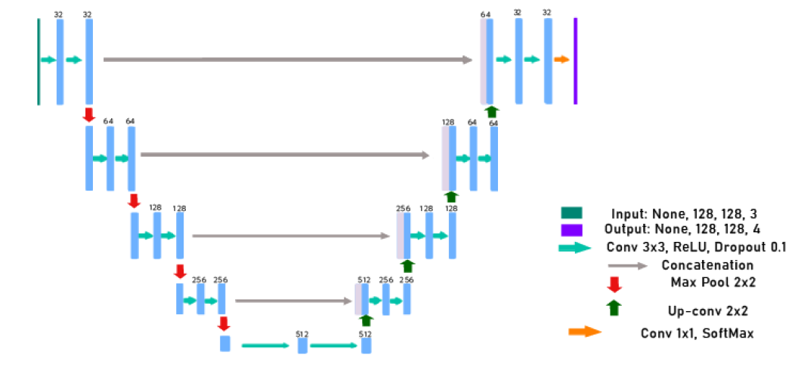

# Brain Tumor Semantic Segmentation using 2D U-Net

A PyTorch implementation of a **2D U-Net** architecture for automated semantic segmentation of lower-grade gliomas (LGG) in brain MRI scans. The pipeline enforces **patient-level data splitting** to eliminate slice-level data leakage and evaluates segmentation quality using pixel-wise accuracy, Intersection over Union (Mean IoU), and the Dice Similarity Coefficient.

---

## Table of Contents
1. [Project Overview](#project-overview)
2. [Dataset](#dataset)
3. [Methodology & Pipeline](#methodology--pipeline)
4. [Model Architecture](#model-architecture)
5. [Results & Visualizations](#results--visualizations)
6. [Repository Structure](#repository-structure)
7. [Installation & Usage](#installation--usage)
8. [Limitations & Future Work](#limitations--future-work)

---

## Project Overview

Accurate localization of brain tumors in Magnetic Resonance Imaging (MRI) is critical for diagnosis, surgical planning, and treatment monitoring. Manual slice-by-slice annotation by radiologists is time-consuming and prone to inter-observer variability. 

This project implements an encoder-decoder **U-Net** convolutional neural network in PyTorch to generate pixel-level binary tumor masks from multi-channel brain MRI slices.

---

## Dataset

* **Source:** [Brain MRI Segmentation Dataset (LGG Segmentation Dataset / TCGA-LGG)](https://www.kaggle.com/datasets/mateuszbuda/lgg-mri-segmentation)
* **Contents:** 3,929 paired 2D brain MRI slices (`.tif`) and corresponding manual FLAIR abnormality segmentation masks (`*_mask.tif`) across **110 patients**.
* **Class Distribution:** Contains both tumor-positive slices and healthy (empty-mask) slices, reflecting realistic clinical screening conditions.

> **Note:** Raw MRI files are excluded from version control due to size constraints. See [`data/README.md`](data/README.md) for download and placement instructions.


---

## Methodology & Pipeline

1. **Automated Pair Matching & Cleaning:**
   * Recursively scans patient directories using `pathlib` to pair each MRI slice with its exact binary mask and extract patient folder identifiers.
2. **Preprocessing:**
   * Resizes MRI images to $128 \times 128$ using bilinear interpolation and binary masks using nearest-neighbor interpolation (`cv2.INTER_NEAREST`) to preserve crisp mask boundaries.
   * Normalizes binary masks to $\{0.0, 1.0\}$ and scales each MRI channel independently to $[0, 1]$ using `MinMaxScaler`.
3. **Leak-Free Patient-Level Splitting:**
   * Uses `GroupShuffleSplit` grouped by `patient_id` (**80% Train / 10% Validation / 10% Test**). All slices from a single patient belong strictly to one split, preventing spatial memorization across adjacent MRI slices.
4. **Online Data Augmentation:**
   * Applies on-the-fly geometric transformations (`HorizontalFlip`, `VerticalFlip`, `RandomRotate90`) via `Albumentations` exclusively to the training split.
5. **Training & Regularization:**
   * Optimized with **Adam** ($\text{lr} = 1 \times 10^{-3}$) and **Binary Cross-Entropy Loss (`BCELoss`)**.
   * Incorporates `BatchNorm2d`, `Dropout` ($p = 0.1$), and **Early Stopping** (patience = 10 epochs) saving the lowest validation-loss checkpoint.

---

## Model Architecture

The segmentation network follows a symmetric 4-stage encoder-decoder **2D U-Net** (`32 -> 64 -> 128 -> 256 -> 512` channels) with skip connections that fuse high-resolution spatial features from the contracting path with deep semantic representations from the expanding path.



*(Place your U-Net architecture diagram at `references/unet_architecture.png` or update the image path above.)*

---

## Results & Visualizations

### Quantitative Evaluation (Held-Out Patient Test Set)

| Metric | Test Set Score |
| :--- | :---: |
| **Pixel Accuracy** | `XX.XX%` |
| **Dice Coefficient** | `0.XXXX` |
| **Mean IoU (Jaccard)** | `0.XXXX` |
| **BCE Loss** | `0.XXXX` |

*(Update the table values above with the final dictionary output from `evaluate_model(...)` and `results/metrics.csv`.)*

### Training & Validation Curves
Loss, Pixel Accuracy, Mean IoU, and Dice Coefficient across training epochs:


### Qualitative Segmentation Predictions
Comparison of input MRI slices, ground-truth radiologist masks, and U-Net predicted masks on unseen test patients:


---

## Repository Structure

```text
brain-tumor-segmentation-unet/
├── README.md
├── requirements.txt
├── .gitignore
├── notebooks/
│   └── brain_tumor_segmentation_unet.ipynb
├── src/
│   ├── __init__.py
│   ├── config.py
│   ├── data/
│   │   ├── __init__.py
│   │   ├── dataset.py
│   │   ├── preprocessing.py
│   │   └── augmentation.py
│   ├── models/
│   │   ├── __init__.py
│   │   └── unet.py
│   ├── training/
│   │   ├── __init__.py
│   │   ├── metrics.py
│   │   ├── engine.py
│   │   └── early_stopping.py
│   └── evaluation/
│       ├── __init__.py
│       ├── evaluate.py
│       └── visualization.py
├── data/
│   └── README.md
├── results/
│   ├── figures/
│   │   ├── training_curves.png
│   │   └── evaluation_examples.png
│   └── metrics.csv
├── checkpoints/
│   └── .gitkeep
└── references/
    └── unet_architecture.png
```

---

## Installation & Usage

### 1. Clone the Repository & Install Dependencies
```bash
git clone https://github.com/<your-username>/brain-tumor-segmentation-unet.git
cd brain-tumor-segmentation-unet
pip install -r requirements.txt
```

### 2. Prepare the Dataset
Download the dataset and extract the `kaggle_3m` folder into `data/kaggle_3m/` (see [`data/README.md`](data/README.md)).

### 3. Run the Notebook or Modular Pipeline
Open and execute `notebooks/brain_tumor_segmentation_unet.ipynb`, which imports directly from `src/` to run preprocessing, training, evaluation, and figure generation.

---

## Limitations & Future Work

* **2D Slice-Based Context vs. 3D Volumetric Context:** Processing MRI scans as independent 2D slices discards inter-slice z-axis continuity. Extending the architecture to a **3D U-Net** or 2.5D multi-slice input would allow the model to leverage full volumetric tumor morphology.
* **Class Imbalance & Loss Function:** Tumor pixels occupy a small fraction of each MRI slice, and many slices contain no tumor at all. Pure Binary Cross-Entropy (`BCELoss`) can be dominated by background pixels; combining **Dice Loss + BCE Loss** or **Focal Tversky Loss** would better penalize false negatives on small lesions.
* **Spatial Resolution Downsampling:** Resizing images from $256 \times 256$ to $128 \times 128$ reduces computational cost but can blur fine tumor boundary details. Training at full $256 \times 256$ resolution with mixed precision (`torch.cuda.amp`) is a natural next step.
* **Single-Institution / Single-Grade Cohort:** The TCGA-LGG dataset focuses specifically on lower-grade gliomas from a limited patient cohort ($N = 110$). External validation on multi-institutional datasets (such as **BraTS**) is required before clinical generalization.
* **Absence of Uncertainty Quantification:** Standard deterministic predictions do not express voxel-level confidence. Incorporating Monte Carlo Dropout at inference time or deep ensembles would help flag ambiguous tumor margins for clinician review.


## Note on Implementation:
While this project is inspired by the architecture and pipeline described in the reference paper (found in references/), the implementation has been adapted for our specific experimental setup:

1) Dataset Split: To prevent data leakage (which is a common pitfall in slice-level random splitting), a rigorous patient-level split (GroupShuffleSplit) was implemented to ensure slices from the same patient do not cross over between train, validation, and test sets.

2) Data Augmentation & Preprocessing: Custom on-the-fly augmentations and normalization pipelines were used.

3) Scope: This repository serves as an independent educational/research implementation focusing on 2D U-Net brain tumor segmentation.